<p align="center">
  
</p>

<p align="center">
  
  
  
</p>

<p align="center">
  
</p>

<p align="center">
  <a href="https://github.com/Mohamed-Rashwan-Bonus?tab=repositories"></a>
</p>

---

### 🛸 `whoami --from-orbit`

```js
const commander = {
  name: "Mohamed Rashwan",
  callsign: "Deep-Space Commander ",
  planet: "Earth 🌍",
  orbit: "Clean Code 🛰️",
  mission: "Ship software that survives re-entry (production)",
  dailyRoutine: ["☕ refuel", "💻 launch code", "🔭 review PRs", "😴 re-enter atmosphere"],
  warpSpeed: "∞ commits / day"
};
```

---

### 🪐 Tech Arsenal — Weapons of Mass Creation

<p align="center">
  
  <br/>
  
</p>

### 🌌 Skills as Planets — كل مهارة كوكب

| Orbit | Planet | Skill | Power |
|-------|--------|-------|-------|
| ☿ Mercury — 6s/orbit ⚡ | **JavaScript / TypeScript** | `warp.drive()` | 🟩🟩🟩🟩⬛ Fast everywhere |
| ♀ Venus — 11s/orbit ✨ | **Python** | `import universe` | 🟩🟩🟩🟩⬛ Clean problem-solver |
| 🌍 Earth+Moon — 17s/orbit 🏠 | **React + HTML/CSS** | `<Home planet />` | 🟩🟩🟩🟩⬛ Where users live |
| ♂ Mars — 24s/orbit 🔴 | **Node.js + Git** | `push --to-mars` | 🟩🟩🟩⬛⬛ Backend warrior |
| ☄ Belt — 55s/orbit 💥 | **Docker + Linux + Tools** | `asteroids.handle()` | 🟩🟩🟩⬛⬛ Debris? No — infra |
| ♄ Saturn — 34s/orbit 👑 | **Flutter + Firebase** | `king.deploy()` | 🟩🟩🟩⬛⬛ Ringed ecosystem |
| 🛸 UFO — random 👽 | **System Design** | `abduct(complexity)` | 🟩🟩⬛⬛⬛ Beaming up knowledge |

> الشمس في النص مكتوب عليها **CODE** — كل الكواكب + حزام الكويكبات + الـ UFO بيلفوا حواليها. السرعة في الجدول = سرعة اللف الحقيقية في الصورة فوق.

---

### 🏆 Galactic Trophies

<p align="center">
  
</p>

---

### 📡 Live Telemetry

<p align="center">
  
  
</p>

<p align="center">
  
  
</p>

---

### 📈 Activity Warp-Graph

<p align="center">
  
</p>

---

### 🐍 The Serpent That Eats My Contributions

<p align="center">
  <picture>
    <source media="(prefers-color-scheme: dark)" srcset="https://raw.githubusercontent.com/Mohamed-Rashwan-Bonus/Mohamed-Rashwan-Bonus/output/github-snake-dark.svg" />
    <source media="(prefers-color-scheme: light)" srcset="https://raw.githubusercontent.com/Mohamed-Rashwan-Bonus/Mohamed-Rashwan-Bonus/output/github-snake.svg" />
    
  </picture>
</p>

> 🤖 Auto-fed every 12h by GitHub Actions. If the snake is missing, check the Actions tab — first run needs manual trigger.

---

### 🌌 Captain's Log — 2026

```
   ✨  .  🚀  .  ✨  .  🪐  .  ✨
  STARLOG 2026.10.16 — systems online ✔
  SNAKE deployed to guard contributions ✔
  NEXT: ship something legendary → v1.0
   ✨  .  🛸  .  ✨  .  ⭐  .  ✨
```

---

### 🛰️ Open a Wormhole

<p align="center">
  <a href="https://github.com/Mohamed-Rashwan-Bonus?tab=repositories">🪐 All galaxies</a> •
  <a href="https://github.com/Mohamed-Rashwan-Bonus/Mohamed-Rashwan-Bonus">👽 Transmission source</a>
</p>


<!-- 🛸 commander: Mohamed-Rashwan-Bonus | warp-drive: enabled | shields: 100% -->
